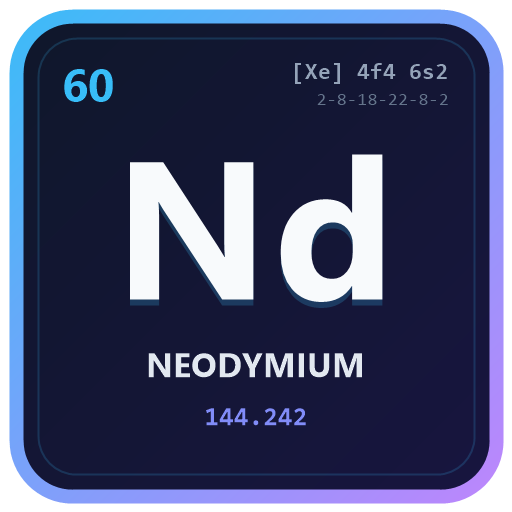

<div align="center">
  
  <h1>Neodymium 2</h1>
  <p><strong>Minecraft 26.3 (Fabric + ServerCore) 구역 인지형 서버 틱 최적화 모드</strong></p>
</div>

> [!NOTE]
> **AI Utilization Disclosure (AI 사용 명시)**  
> 본 프로젝트의 코드 설계, 최적화 모듈 구현, 테스트 및 문서화 과정에는 AI 코딩 어시스턴트(**Google Antigravity**)가 활용되었습니다.  
> *This project was developed, optimized, and documented with the assistance of AI (**Google Antigravity**).*

**Neodymium 2**는 **Minecraft 26.3 (Fabric)** 및 **ServerCore** 환경을 위한 구역 인지형(Region-Aware) 서버 틱 최적화 모드입니다.  
지정된 **바닐라 민감도 보호 구역(농장·회로·주민 시설 등)** 내부는 바닐라 틱과 동작을 100% 보존하고, 보호 구역 외부의 야생 영역에만 공격적인 엔티티·월드·스폰·주민 Brain 최적화를 적용합니다.

---

## 주요 기능

* **구역 인지형 ServerCore 연동**: 보호 구역 내부 엔티티는 항상 정상 틱을 유지하고, 구역 외부 엔티티는 동적 활성 범위(EAR) 및 틱 간격을 적용합니다.
* **주민 AI (Brain) 유지보수 최적화**: 구역 외부의 거래/대기 주민 Brain 연산을 생략하면서도 거래 재입고, 가격 변동, 좀비 치료 할인, 마을의 영웅 선물, 작업대 탐색(`PoiRevisionGrid`)은 바닐라와 동일하게 유지합니다.
* **구역 외 스폰 · 엔티티 · 월드 최적화**: 구역 외 자연 스폰 간격 조절, 원거리 AI/밀치기 생략, 유휴 블록 엔티티·유체·랜덤 틱 감속 및 레이지 청크 투사체 정리를 수행합니다.
* **단독 사용 & 외부 구역 플러그인 연동 지원**:
  * **단독 사용 (Standalone)**: 별도의 구역 모드 없이 내장 `/neodymium2 chunk` 명령어로 보호 청크를 직접 지정할 수 있습니다.
  * **외부 연동 (Public API)**: `NeodymiumApi` 및 `NeodymiumRegionProvider`를 통해 `YAWPManager` 등 외부 구역 관리 모드와 연동할 수 있습니다.

---

## 요구 사항

* **Minecraft**: `26.3`
* **Fabric Loader**: `>=0.19.3`
* **Java**: `>=25`
* **필수 모드**: `fabric-api`, `servercore` (`1.5.20+26.3`)
* **선택 연동 모드**: `yawp`, `yawpmanager`, `carpet-fga-addition`, `farmersdelight`, `brewinandchewin`, `carpet-tis-addition`

---

## 명령어 (`/neodymium2`)

관리자 권한(OP)이 필요하며, 채팅창 클릭형 UI를 제공합니다.

### 기본 관리
* `/neodymium2 status` — 현재 MSPT/TPS, 보호 구역 수, 모듈별 최적화 통계 확인
* `/neodymium2 modules` — 활성화된 최적화 모듈 목록 확인
* `/neodymium2 regions [page]` — 보호 구역 및 보호 청크 목록 확인 (`[이동]`, `[관리]`, `[해제]` 버튼 제공)
* `/neodymium2 nametags [page]` — 로드된 이름표 엔티티 보호/차단 현황 확인
* `/neodymium2 reload` — `config/neodymium2/config.json` 및 `regions.json` 다시 불러오기

### 단독 사용용 청크 보호 지정 (`/neodymium2 chunk`)
* `/neodymium2 chunk toggle` — 현재 서 있는 청크의 바닐라 민감도 보호 ON / OFF 토글
* `/neodymium2 chunk add` — 현재 서 있는 청크 보호 추가
* `/neodymium2 chunk add <radius>` — 현재 청크 중심 정사각형 반경(`0~16` 청크) 범위 보호 추가
* `/neodymium2 chunk add <chunkX> <chunkZ>` — 지정한 청크 좌표 보호 추가
* `/neodymium2 chunk add <x1> <z1> <x2> <z2>` — 직사각형 청크 범위 보호 추가
* `/neodymium2 chunk remove [<chunkX> <chunkZ>]` — 현재(또는 지정) 청크 보호 해제

---

## Public API (`kr.harusarri.neodymium2.api`)

외부 구역 관리 모드(예: `YAWPManager`)에서 `Neodymium 2`를 호출할 때 사용하는 공개 API입니다.

```java
// 1. 외부 구역 제공자 등록
NeodymiumApi.registerRegionProvider(myRegionProvider);

// 2. 특정 구역의 바닐라 민감도 조회 및 변경
boolean sensitive = NeodymiumApi.isVanillaSensitive("minecraft:overworld", "my_region");
NeodymiumApi.setVanillaSensitive("minecraft:overworld", "my_region", !sensitive);

// 3. 외부 구역 변경/이름 변경/삭제 이벤트 알림
NeodymiumApi.onRegionMutated();
NeodymiumApi.onRegionRenamed("minecraft:overworld", "old_id", "new_id");
NeodymiumApi.onRegionRemoved("minecraft:overworld", "deleted_id");

// 4. 위치/엔티티 보호 여부 조회
boolean entityProtected = NeodymiumApi.isProtected(entity);
boolean blockProtected  = NeodymiumApi.isProtectedBlock(level, blockPos);
boolean chunkProtected  = NeodymiumApi.isProtectedChunk(level, chunkX, chunkZ);
```

---

## 참조 프로젝트 및 출처 (Credits & References)

**Neodymium 2**의 구역 외부 최적화 모듈들은 아래 오픈소스 마인크래프트 서버 및 최적화 프로젝트들의 설계 아이디어와 알고리즘을 참조하여, **보호 구역 내부는 100% 바닐라를 유지하고 외부 야생 영역에만 선택적으로 적용**되도록 재설계·구현되었습니다.

* **[PaperMC / Paper](https://github.com/PaperMC/Paper)** — 비전투 엔티티 A* 길찾기 실패 백오프(Pathfinding Backoff), 3D 구체 디스폰 반경 사전 필터링(3D Sphere Despawn Pre-Filter), 폭발 가시성 레이캐스트 캐시(`ServerExplosion.getSeenPercent`), 발전과제 트리거 최적화 개념 참조
* **[Pufferfish](https://github.com/pufferfish-gg/Pufferfish)** — 거리 제곱 비례 동적 AI 틱 감속(**DAB**, Dynamic Activation of Brain & GoalSelector) 및 원거리 투사체 처리 아이디어 참조
* **[Purpur](https://github.com/PurpurMC/Purpur)** — 갇힌 주민 AI 생략(`Villager Lobotomization`) 및 거래 재입고 유지 개념 참조
* **[Gale](https://github.com/GaleMC/Gale) / [Leaf](https://github.com/Winds-Studio/Leaf) / [Petal](https://github.com/Bloom-host/Petal)** — 시야 레이캐스트(`Sensing`) 캐시 유지, `Brain` 메모리 모듈 평탄 배열 직접 인덱싱(Flat-Array Memory Indexing), 정지 엔티티 트래커 더티 게이트(Stationary Tracker Gate) 아이디어 참조
* **[ServerCore](https://github.com/Wesley1808/ServerCore)** (`Wesley1808`) — Fabric 환경의 엔티티 활성화 범위(Activation Range, EAR) 및 기본 설정 프레임워크 연동 기반
* **[Lithium](https://github.com/CaffeineMC/lithium)** (`CaffeineMC`) — `Brain` 실행 태스크 캐시 호환(`BrainTaskCache`) 및 `<lithium_sleeping>` 휴면 블록 엔티티 Active-Set 압축 구조 참조
* **[Fabric Carpet](https://github.com/gnembon/fabric-carpet) / [Carpet-TIS-Addition](https://github.com/TISUnion/Carpet-TIS-Addition)** — `lagFreeSpawning` (고속 AABB 충돌 판정 및 Mob 인스턴스 프리쿠킹 캐시), 가짜 플레이어(`EntityPlayerMPFake`) 발전과제 조건 생략, 비활성 `MicroTiming` 로거 단락 호환성 참조
* **[Yet Another World Protector (YAWP)](https://github.com/Z0rdak/Yet-Another-World-Protector)** — 선택적 보호 구역 연동 및 `FlagEvaluator` 위치 캐시 대상

---

## 라이선스

* [MIT License](./LICENSE)
